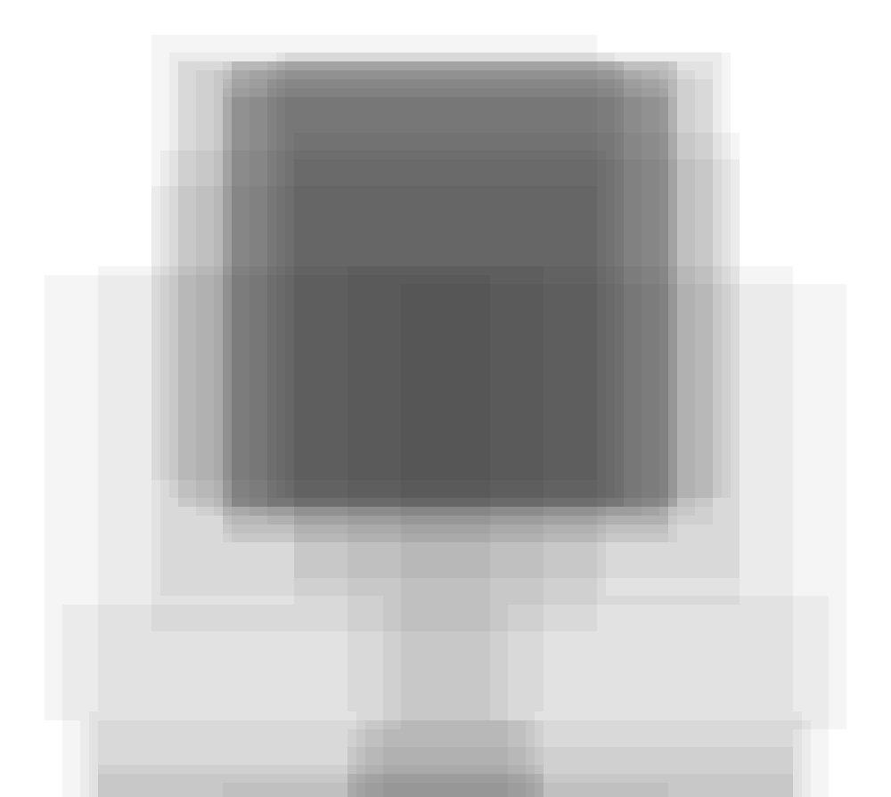

# Square Tree

A challenge: draw a tree using exactly 100 identical 200x200 translucent gray squares on a 1000x1000 canvas. Squares may be placed anywhere, including off the canvas.

Rather than placing the squares by hand, `main.ts` describes the tree as a target darkness map (canopy, trunk, ground) and uses simulated annealing to move the squares around until their overlapping layers match it as closely as possible.



## Bigger squares

The square size and opacity can be passed on the command line. With 500x500 squares (`tsx main.ts 500 0.04`), each square covers a quarter of the canvas, so detail has to come from where squares overlap and where they stop. The canopy's corners get softened by stacking many faint, offset squares, and the trunk is the narrow gap left between two groups of squares:


## Many trees

Each run picks a random tree to aim for (where it stands, how it leans, how big and lumpy the canopy is, where the ground is), so every run draws a different one. Set `FIXED_TREE=1` to always aim for the same tree. An optional fourth argument names the output file, so you can render a batch in parallel:

```
mkdir -p versions
seq -w 1 100 | xargs -P 10 -I{} tsx main.ts 500 0.04 versions/tree-{}.png
```
